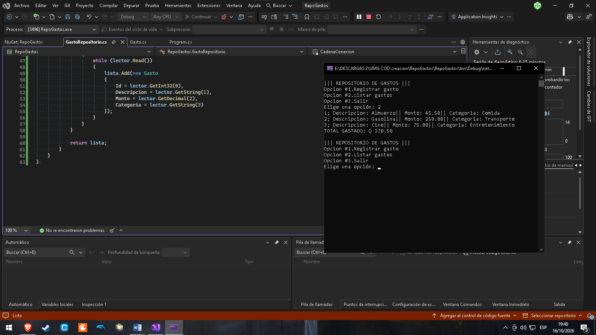
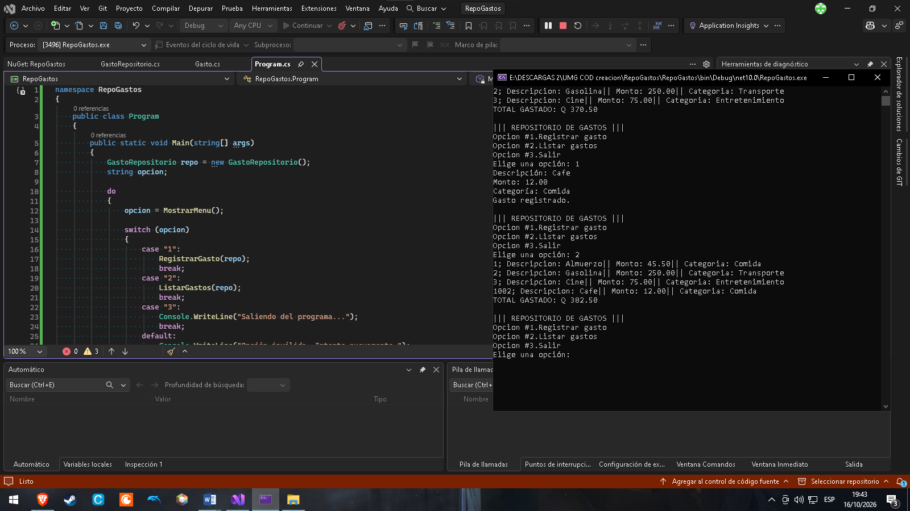
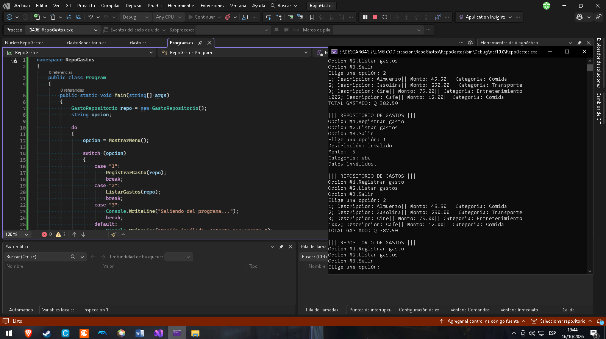
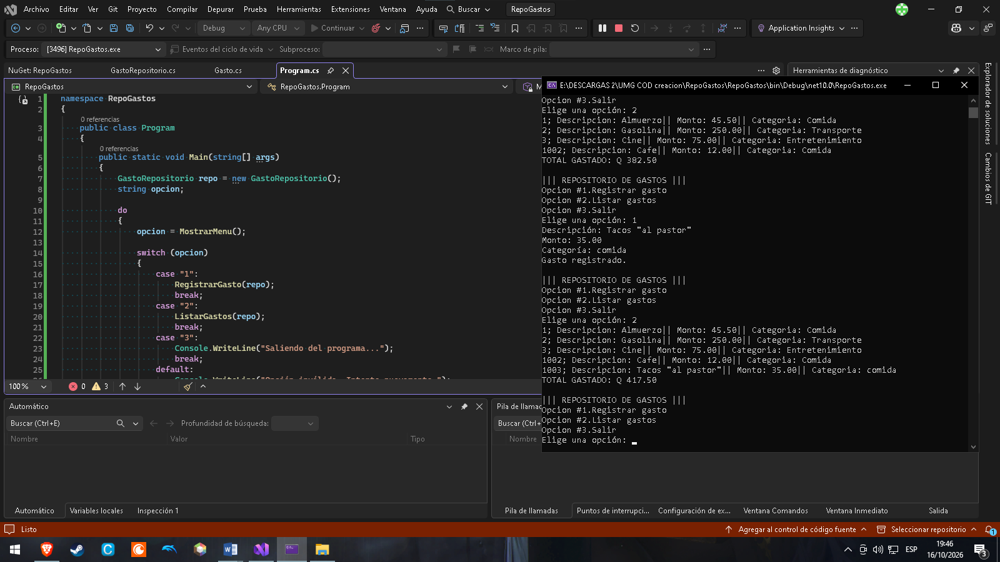

## Nombre del Proyecto ||| Registro de Gastos
# Pasos para ejecutarlo
- | Abrir Visual Studio Community 2026
- | Ejecutar el script crear_GastosDB.sql en una nueva consulta de (localdb)\MSSQLLocalDB la base de datos aún no existe.
- | Abrir el proyecto y presionar "F5" o "Ctrl+F5" para ejecutarlo

## Capturas
## Escenario 1

## Escenario 2

## Escenario 3

## Escenario 4:

## Video explicando el codigo
https://drive.google.com/file/d/1Ybz3amkaZOAFFNW1OJj_SthavoimOL3g/view?usp=drive_link

